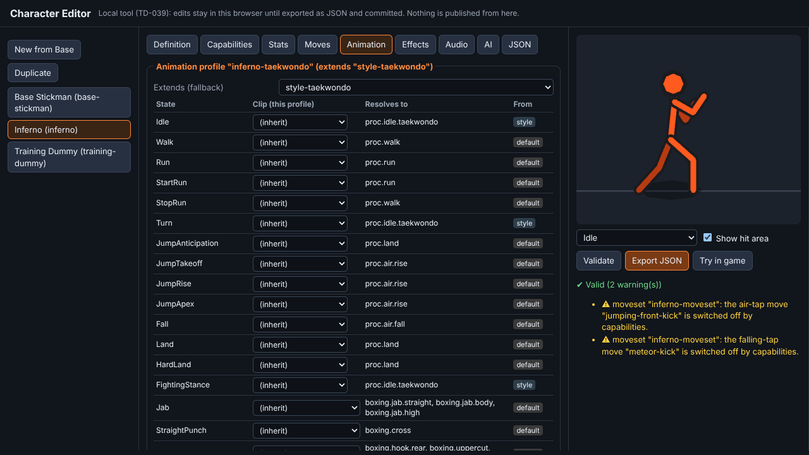
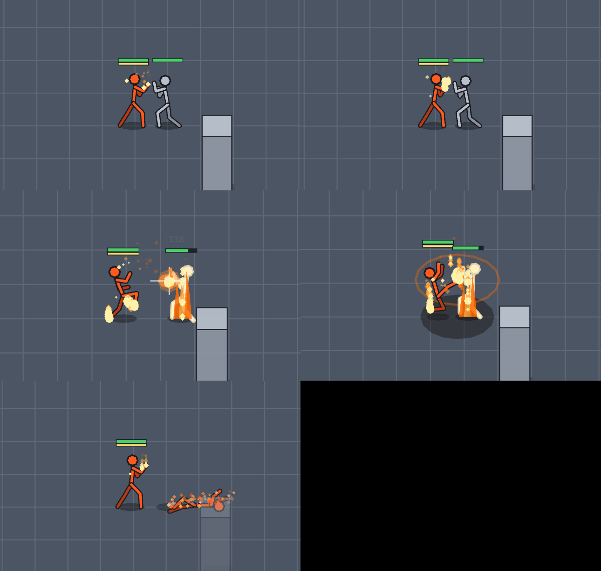

# How to create and configure a stickman (TD-039)

Every stickman is **data**: one Character Definition plus reusable profiles, all JSON under `src/data/characters/`. The shared systems (movement, combat, animation, hit areas, Punch Clash, damage, defeat) read the resolved character at runtime. There are **no character-name checks in shared code**, and an automated test enforces that.

You can edit the JSON directly, or use the **Character Editor** (`admin.html`: `npm run dev`, then open `/admin.html`).



## 1. Where things live

```
src/data/characters/
  shared/                        reusable profiles any character can use
    animation-default.json       "shared-default": a clip for EVERY state (the last fallback)
    animation-style-boxing.json  "style-boxing"     (extends shared-default)
    animation-style-taekwondo.json "style-taekwondo" (extends shared-default)
    effects-default.json         "default-effects"
    audio-default.json           "default-audio"
    ai-default.json              "default-ai"
  base-stickman/                 THE TEMPLATE: duplicate this to start a new fighter
    character.json  animation-profile.json  moveset.json  stats.json
  inferno/                       the complete example (fire, taekwondo)
    character.json  animation-profile.json  moveset.json  stats.json  effects.json  audio.json
  training-dummy/                Practice opponent (template: base-stickman)
    character.json  stats.json  ai.json

src/characters/                  shared code: schema, library, resolve (fallbacks), validate, load
src/admin/                       the Character Editor (admin.html)
```

The shared systems are: character controller `src/app/scenes/fighter-entity.ts`; combat controller `src/combat/moves.ts` and `FightArenaScene.applyStrike`; animation state machine `src/animation/animator.ts` plus the clip library `src/animation/clips.ts`; hitbox system `src/combat/attacks.ts`; clash system `src/combat/clash.ts` and `scene-clash.ts`; damage system `src/combat/combatant.ts`; defeat system `FightArenaScene.koDissolve`.

## 2. Create a new stickman (10 steps)

1. **Duplicate the Base Stickman.** In the editor, click **New from Base** and enter an id (for example `ronin`). By hand, copy `base-stickman/` to `ronin/`.
2. **Enter the id and display name** in `character.json` (`id`, `displayName`, `description`). Set `"template": "base-stickman"`: any field you leave out is taken from the template.
3. **Rig:** set `rig.bones` (metres) and `rig.colour`, `colourBack` and `outline` (`#rrggbb`).
4. **Animation Profile:** set `profiles.animation`. Make your own profile that `extends` a combat style (`style-boxing` or `style-taekwondo`), and only list the states you want to look different (see §3).
5. **Moveset Profile:** set `profiles.moveset` (see §4).
6. **Capabilities:** switch abilities on or off (see §5).
7. **Statistics:** set `profiles.stats` (see §6).
8. **Effects and audio:** set `profiles.effects` and `profiles.audio` (see §7). Choose an ability kit with `abilityKit` (or `null`).
9. **Validate:** the editor validates live; tests run `validateCharacter` for every built-in character (`npm test`).
10. **Test and publish:** **Try in game** plays your draft (`?character=draft`, this browser only). To publish, **Export JSON**, split the bundle into the files above, add them to `src/characters/library.ts` (one import each), and commit. Play it with `?character=<id>`.

A new character never needs edits to the combat controller or any other shared system.

## 3. Assigning animations

An Animation Profile maps **states** to **clip ids**: one clip, or a list to vary between, for example `"Jab": ["boxing.jab.straight", "boxing.jab.body", "boxing.jab.high"]`. The 50 states are listed in `src/characters/schema.ts` (`ANIMATION_STATES`).

- **Strike states** (punches, kicks, aerial kicks, `ClashLoop`, `ClashWin`, `ClashFinisher`) need **strike clips** (`boxing.*`, `std.*`, `tkd.*`, `inferno.*`). These are keyframed shapes played over each move's own timing.
- **All other states** (idle, gait, jumps, guard, hits, falls, get-up, defeat) need **procedural clips** (`proc.*`). These are code-driven motions.
- The available clips are listed in `src/animation/clips.ts` (and in the editor's drop-downs). A brand-new clip shape is added there, once, and is then usable from data by any character.

**Fallback order** for every state:

1. the character's own profile
2. its combat-style profile (`extends`)
3. the shared default profile (`shared-default`)
4. a **safe fallback clip** (`safe.strike` or `proc.safe`), with a `[animation fallback]` warning in the console (development builds) and in the editor

The editor's Animation tab shows the clip each state resolves to, and its tier: character, style, default or safe. An unknown or wrong-kind clip id is a validation error, and that entry is skipped, so the next tier is used. Required states (`REQUIRED_STATES`, for example `Idle`, `Knockdown`, `Faint`, `Defeat`) must resolve somewhere other than the safe clip.

## 4. Configuring moves (Moveset Profile)

The Animation Profile decides how a move looks. The Moveset Profile decides what it does.

```jsonc
{
  "id": "meteor-kick",
  "displayName": "Downward fire kick",
  "animationState": "DownwardAerialKick",  // looked up in the Animation Profile
  "category": "kick",                      // punch | kick (picks damage multiplier, effects, sounds)
  "heavy": true, "aerial": true,           // heavy knocks down; aerial = an air move (once per jump)
  "startupS": 0.08, "activeS": 0.14, "recoveryS": 0.26,  // SECONDS (fixed-step deterministic)
  "cancelAt": 1,                           // 0..1 of recovery: when the next combo move may start
  "hitbox": { "reachM": 0.85, "radiusM": 0.7 },  // capsule from the body to reach
  "damage": 120, "strength": 900,          // strength: doors and furniture
  "knockbackMps": 6, "lungeMps": 1.5, "moveFactor": 0.6,
  "impact": "fire-heavy",                  // flash, recoil, hit-stop, shake (src/data/combat/impacts.ts)
  "shake": 0.7, "zoomPunch": 0.07,
  "next": { "tap": "…" },                  // combo routes by input
  "effect": "ground-fire-explosion",       // extra effect on contact
  "status": { "burn": { "dps": 15, "durationS": 2 } },
  "groundBounce": true,
  "requires": ["canUseDownwardKick"]       // capabilities it needs
}
```

- **Inputs** (still five combat buttons, INV-9): `tap` (Button 1), `tap-forward` (Button 1 while pushing firmly toward where you face), `air-tap` (in the air) and `falling-tap` (in the air, coming down). `starters` names the first move for each input; `next` chains moves. A buffered press flows into the next move at its cancel point. Each strike varies its look between the clips listed for its state, never the same twice in a row.
- **Implicit requirements:** kicks need `canKick`, punches `canPunch`, and aerial moves need `canJump` plus `canUseAerialKicks` (or `canUseAerialPunches`). A move whose requirements are off is removed, along with routes to it.
- **Multipliers** from the Stats Profile apply on load: damage by punch, kick or aerial; attack speed divides the timings; knockback.

## 5. Capabilities

Set in `character.json` → `capabilities` (`true` or `false`):

| Capability | Effect |
|---|---|
| `canWalk`, `canRun` | No movement, or a walking-pace cap |
| `canJump`, `canDoubleJump` | Jump input; a second jump in the air |
| `canPunch`, `canKick`, `canUseCombos`, `canUseAerialPunches`, `canUseAerialKicks`, `canUseDownwardKick`, `canUseSpinningKick` | Which moves and routes exist |
| `canBlock`, `canParry` | Hold-to-guard; a well-timed guard parries |
| `canUsePunchClash` | A sustained exchange may become a Punch Clash |
| `canWallBounce`, `canGroundBounce` | Knocked into walls: bounce or stop; floor bounces from moves that have them |
| `canDisintegrate` | Defeat dissolves into the effects profile's dust, or the body stays down |
| `usesElementalEffects`, `usesFireEffects` (`usesElectricEffects`, `usesIceEffects`) | Elemental trails, auras and embers show only when on |
| `isBossCharacter`, `isPlayable`, `isAIControlled` | Roster flags (menus and modes, Phases 10–13) |

Switching a capability off never leaves broken states: the moves and routes that need it are removed, and validation warns if an input is left with nothing to do.

## 6. Statistics (Stats Profile)

`maxHp`, `maxStamina`, stamina regeneration, movement (`maxSpeedMps`, `accelMps2`, `decelMps2`, `jumpSpeedMps`, `gravityMps2`), `body` (`footRadiusM`, `massKg`), `power`, `defence`, `critChance`, `critMultiplier`, `knockbackResistance`, `hitStunResistance`, and `multipliers` (`attackSpeed`, `punchDamage`, `kickDamage`, `aerialDamage`, `knockback`, `movementSpeed`, `jumpForce`, `clashPower`, `specialCharge`). Every value has safe limits (`LIMITS` in `schema.ts`; the editor shows them as tooltips).

## 7. Effects and audio

- **Effects Profile:** effect ids from `src/vfx/effects-library.ts` for `punchImpact`, `kickImpact`, `heavyImpact`, `blockImpact`, `limbTrail` (for example `flame-limbs`: flames on the striking fists or feet), `aura` (for example `fire-aura`), `clash`, `finisher`, `disintegration` (for example `ember-ash`), plus `flashColour`, `shakeScale` and `hitstopScale`. Effects fire from combat events, never from inside animations.
- **Audio Profile:** lists of sound ids (`src/audio/sound-board.ts`) for `lightPunch`, `heavyPunch`, `lightKick`, `heavyKick`, `block`, `parry`, `footstep`, `jump`, `land`, `wallImpact`, `clash`, `finisher`, `defeat` and `disintegration`. One is picked at random each time, on top of the synthesiser's own small pitch variation.
- **AI Behaviour Profile:** `attackEveryS`, `aggression`, `clashMashRate`, `settleDecelMps2` and `reactionS`. Today only the Practice dummy is AI; full AI arrives in Phase 10.
- **Unlock:** `unlockedByDefault`, `tokenCost` (in-game tokens) and `requirement`. This is display data only; unlocks are decided server-side in Phase 14.

## 8. Validation rules (`src/characters/validate.ts`)

**Errors** stop a character from being used. The game falls back to the Base Stickman and shows the first error in the status bar.

- Missing or unknown profiles, template, ability kit, effect or sound ids.
- Values out of range: negative health, zero-length or negative timings, infinite or NaN numbers, bad colours, unknown capabilities.
- Animation profiles: unknown states, unknown clips, the wrong kind of clip for a state, `extends` loops, and required states with no clip anywhere in the chain.
- Moves: duplicate ids; animation states that are not attack states; combo routes to missing moves, back to the same move, or between ground and air moves; starters on the wrong kind of input.

**Warnings** do not block a character: fallback (safe) animations in use, moves switched off by capabilities, inputs with no move, and elemental effects set while `usesElementalEffects` is off.

## 9. Inferno, the worked example

- **Identity:** fire element, taekwondo style, starter fighter.
- **Animation:** profile `inferno-taekwondo` extends `style-taekwondo`, which extends `shared-default`. Inferno's own clips are the fire roundhouse, the meteor kick and a flame-uppercut clash finisher. It inherits taekwondo kicks and the taekwondo stance, and everything else comes from the shared default.
- **Moves:**
  - Tap string: jab → straight → fire roundhouse (burns).
  - Forward-tap string: front kick → side kick → spinning hook kick.
  - Air: jumping front kick.
  - Falling: downward fire kick, with a ground fire explosion, ground bounce and burn.
- **Stats:** kick damage ×1.25, attack speed ×1.15, movement ×1.05, jump ×1.1, knockback ×1.15.
- **Effects:** flame bursts, flames around the fists and feet while attacking, a fire aura, fire clash and finisher effects, and an ember-and-ash disintegration.
- **Audio:** fire variations for heavy hits and the finisher.
- **Abilities:** the `inferno-kit` (Fire Bolt, Flame Dash, Eruption, Meteor Fist).


